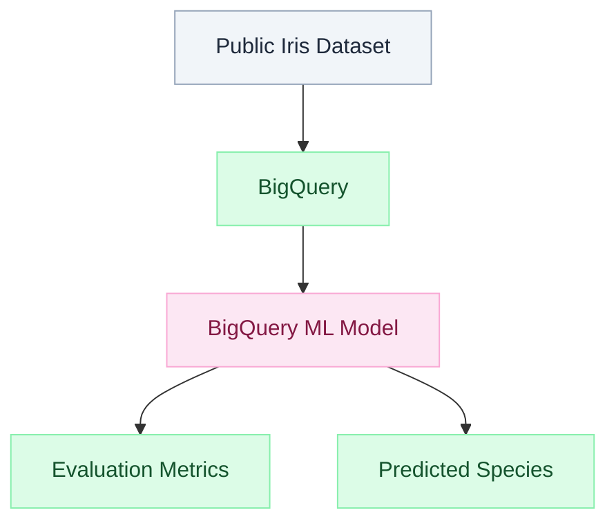

# BigQuery ML Hands-On Lab: Multiclass Classification

← [Back to Domain 1](../index.md) | [Back to PMLE Learning Path](../../index.md)

**Exam mapping:** Domain 1 — Architecting low-code AI solutions (~13%); objective 1.1 — developing ML models using BigQuery ML or AutoML on Gemini Enterprise Agent Platform.

**Estimated time:** 45–60 minutes  
**Environment:** Google Skills temporary Google Cloud project  
**Services:** BigQuery and BigQuery ML  
**Dataset:** `bigquery-public-data.ml_datasets.iris`

## 1. Learning objectives

By the end of this lab, you will be able to:

- Identify a supervised classification problem, its features, and its label.
- Inspect a public BigQuery dataset.
- Create a BigQuery dataset in the correct location.
- Train a multiclass logistic regression model with SQL.
- Evaluate classification metrics on held-out data.
- Generate predictions for new examples.
- Explain when BigQuery ML is a suitable low-code option.

This is an introductory practical exercise for objective 1.1. It does **not** cover all of Domain 1. You must also study regression, forecasting, clustering, feature engineering, AutoML, Gemini fine-tuning with BigQuery, AI APIs, Model Garden, and application optimization.

## 2. Scenario and architecture

A botanic research team has measurements for iris flowers and wants to predict each flower's species. The training dataset includes four numeric measurements and a known species label.

This is a supervised **multiclass classification** problem:

- Features: sepal length, sepal width, petal length, petal width.
- Label: species.
- Model: BigQuery ML logistic regression classifier.
- Output: one predicted species from the classes represented in the training data.

### Architecture



## 3. Start the Google Skills lab

1. Open the [Google Skills Professional Machine Learning Engineer learning path](https://www.skills.google/paths/17).
2. Sign in and review the available activities. Start a BigQuery or BigQuery ML activity that provides a temporary Google Cloud project.
3. Start the lab timer and read the lab-specific instructions.
4. Open the Google Cloud Console using the link supplied by Google Skills.
5. In the project selector, confirm that the **temporary lab project** is active.
6. Open BigQuery and select the SQL query editor.

!!! important "Use the lab project only"
    Copy the project ID from the active Google Skills lab. Do not use a project ID from another lab session or your personal Google Cloud account. Google Skills activities can have different permissions, quotas, and cleanup rules.

!!! note "If this exact activity is not in the current Skills path"
    The learning path is updated over time and contains 17 activities, not a fixed set of one-to-one exam labs. Launch a BigQuery ML lab from Google Skills that grants BigQuery model-creation permissions. If no suitable lab is available in your account, do not assume the temporary project has the required permissions; use the official BigQuery ML documentation as a reference and resume this exercise in a permitted lab environment.

## 4. Inspect the source data

In the BigQuery SQL editor, run:

```sql
SELECT
  *
FROM
  `bigquery-public-data.ml_datasets.iris`
LIMIT 10;
```

You should see the four measurement columns and a `species` column.

Check the number of records per species:

```sql
SELECT
  species,
  COUNT(*) AS row_count
FROM
  `bigquery-public-data.ml_datasets.iris`
GROUP BY
  species
ORDER BY
  species;
```

### Understand the ML problem

| Column | Role | Why |
|---|---|---|
| `sepal_length` | Feature | Measurement used to predict species |
| `sepal_width` | Feature | Measurement used to predict species |
| `petal_length` | Feature | Measurement used to predict species |
| `petal_width` | Feature | Measurement used to predict species |
| `species` | Label | Known answer the model learns to predict |

Because the label contains more than two possible classes, this is multiclass classification.

## 5. Create a dataset for the model

Copy the project ID from the Google Skills lab details and replace `YOUR_PROJECT_ID` in the following statement:

```sql
CREATE SCHEMA IF NOT EXISTS `YOUR_PROJECT_ID.pmle_lab`
OPTIONS (
  location = 'US'
);
```

The public Iris table is in the US multi-region. Create the destination dataset in the US location so that the model-training query can read the source table and write the model in a compatible location.

If the lab already provides a dataset, use the lab-provided dataset and location instead of creating another one.

## 6. Train a multiclass logistic regression model

Run the following query after replacing the project ID:

```sql
CREATE OR REPLACE MODEL `YOUR_PROJECT_ID.pmle_lab.iris_logistic_model`
OPTIONS (
  MODEL_TYPE = 'LOGISTIC_REG',
  INPUT_LABEL_COLS = ['species'],
  DATA_SPLIT_METHOD = 'AUTO_SPLIT',
  DATA_SPLIT_EVAL_FRACTION = 0.2
) AS
SELECT
  sepal_length,
  sepal_width,
  petal_length,
  petal_width,
  species
FROM
  `bigquery-public-data.ml_datasets.iris`;
```

Wait for the query job to complete. In the BigQuery Explorer, expand your project, the `pmle_lab` dataset, and Models. You should find `iris_logistic_model`.

### Understand the SQL

| SQL option | Purpose |
|---|---|
| `CREATE OR REPLACE MODEL` | Creates the model or replaces a model with the same name |
| `MODEL_TYPE = 'LOGISTIC_REG'` | Selects logistic regression for classification |
| `INPUT_LABEL_COLS = ['species']` | Identifies the target label |
| `DATA_SPLIT_METHOD = 'AUTO_SPLIT'` | Lets BigQuery ML split data into training and evaluation sets |
| `DATA_SPLIT_EVAL_FRACTION = 0.2` | Requests 20% evaluation data |

BigQuery ML determines whether logistic regression is binary or multiclass from the number of distinct label values. You do not need a separate multiclass model type.

!!! tip "Why start with BigQuery ML?"
    BigQuery ML is useful when data is already in BigQuery and the task can be handled by a supported model type. It lets you create and use models with SQL without first exporting the training data to a separate custom training environment. It is not automatically the best option for every ML workload.

## 7. Evaluate the model

Run:

```sql
SELECT
  *
FROM
  ML.EVALUATE(
    MODEL `YOUR_PROJECT_ID.pmle_lab.iris_logistic_model`
  );
```

Because the model was created with an automatic data split, BigQuery ML evaluates it using the reserved evaluation data.

For classification, review the metrics returned by `ML.EVALUATE`:

| Metric | Meaning | When it matters |
|---|---|---|
| Accuracy | Fraction of predictions that are correct | Useful as an overall measure, but can hide weak minority-class results |
| Precision | Correct positive predictions divided by all positive predictions | Important when false positives are costly |
| Recall | Correct positive predictions divided by all actual positive examples | Important when false negatives are costly |
| F1 score | Harmonic mean of precision and recall | Useful when balancing precision and recall |
| Log loss | Penalizes incorrect and overconfident probability predictions | Lower is generally better |
| ROC AUC | Measures ranking quality | Interpret in the context of the classification task and averaging method |

Do not memorize a target score for this small dataset. Focus on what each metric means and which business consequence it represents. Accuracy alone is not enough when classes are imbalanced or the cost of errors differs by class.

## 8. Generate a prediction

Run a prediction for a new flower measurement:

```sql
SELECT
  *
FROM
  ML.PREDICT(
    MODEL `YOUR_PROJECT_ID.pmle_lab.iris_logistic_model`,
    (
      SELECT
        5.1 AS sepal_length,
        3.5 AS sepal_width,
        1.4 AS petal_length,
        0.2 AS petal_width
    )
  );
```

Inspect the returned columns:

- `predicted_species` is the model's predicted class.
- `predicted_species_probs` contains the class probability information returned by BigQuery ML.
- The input features are included in the prediction output.

A probability is a model estimate, not a guarantee that the prediction is correct.

## 9. Optional extension: compare another classifier

Create a boosted tree classifier using the same source data:

```sql
CREATE OR REPLACE MODEL `YOUR_PROJECT_ID.pmle_lab.iris_boosted_tree`
OPTIONS (
  MODEL_TYPE = 'BOOSTED_TREE_CLASSIFIER',
  INPUT_LABEL_COLS = ['species'],
  DATA_SPLIT_METHOD = 'AUTO_SPLIT',
  DATA_SPLIT_EVAL_FRACTION = 0.2
) AS
SELECT
  sepal_length,
  sepal_width,
  petal_length,
  petal_width,
  species
FROM
  `bigquery-public-data.ml_datasets.iris`;
```

Evaluate the second model:

```sql
SELECT
  *
FROM
  ML.EVALUATE(
    MODEL `YOUR_PROJECT_ID.pmle_lab.iris_boosted_tree`
  );
```

Compare the metrics and training characteristics. Do not choose a model based on a single metric alone. In a real project, use representative data, a split strategy that reflects the production use case, and a validation process that avoids leakage.

## 10. Troubleshooting

| Problem | What to check |
|---|---|
| Access denied when creating a model | Confirm that the active Skills lab grants BigQuery model-creation permissions |
| Dataset location error | Create the destination dataset in US, matching the public source table location |
| Project not found | Use the project ID from the currently active Skills lab |
| Model not visible | Refresh BigQuery Explorer and expand the correct project and dataset |
| SQL syntax error | Confirm GoogleSQL is selected and replace every `YOUR_PROJECT_ID` placeholder |
| Lab quota or timeout | Follow the active lab's quota and timer instructions; avoid repeatedly launching training jobs |

## 11. Cleanup

If you created the dataset in a project you control, delete it after the exercise:

```sql
DROP SCHEMA `YOUR_PROJECT_ID.pmle_lab` CASCADE;
```

If you are using a Google Skills temporary project, follow that lab's cleanup instructions. Do not delete resources outside your lab scope.

## 12. Quick Quiz — BigQuery ML Classification

<quiz>
### Question 1

Which BigQuery ML model type supports binary and multiclass classification?

- [ ] `LINEAR_REG`
- [x] `LOGISTIC_REG`
- [ ] `KMEANS`
- [ ] `ARIMA_PLUS`

### Question 2

A fraud model misses too many fraudulent transactions. Which metric should you examine closely?

- [x] Recall
- [ ] Training duration
- [ ] Storage size
- [ ] Query bytes processed

### Question 3

Which BigQuery ML function generates predictions from a trained model?

- [x] `ML.PREDICT`
- [ ] `ML.TRAIN`
- [ ] `ML.DEPLOY`
- [ ] `ML.SERVE`
</quiz>

---

### Want More Practice?

Continue with the [DevOpsPilot quiz hub](../../../../../quiz/index.md). The certification-specific PMLE question bank will be expanded as the course grows.

## 13. Completion checklist

- [ ] Started a Google Skills lab with BigQuery access.
- [ ] Confirmed the active temporary project ID.
- [ ] Inspected the public Iris dataset and its label distribution.
- [ ] Created a dataset in the US location.
- [ ] Trained the logistic regression classifier.
- [ ] Evaluated the model on held-out data.
- [ ] Generated a prediction.
- [ ] Completed the knowledge check.
- [ ] Cleaned up resources or confirmed the lab's expiry process.

## 14. What to remember for the exam

1. BigQuery ML is a good fit when the data is in BigQuery and a supported SQL-based model meets the requirement.
2. Logistic regression can perform binary and multiclass classification.
3. Understand the difference between features and labels.
4. Know the purpose of `CREATE MODEL`, `ML.EVALUATE`, and `ML.PREDICT`.
5. Select metrics based on the impact of false positives and false negatives.
6. Know when to move beyond BigQuery ML to AutoML, custom training, or a foundation model.

## Official references

- [PMLE exam guide — June 1, 2026](https://services.google.com/fh/files/misc/professional_machine_learning_engineer_exam_guide_english_new.pdf)
- [Google Skills PMLE learning path](https://www.skills.google/paths/17)
- [Create a BigQuery ML model using SQL](https://cloud.google.com/bigquery/docs/create-machine-learning-model)
- [BigQuery ML model types](https://cloud.google.com/bigquery/docs/reference/standard-sql/bigqueryml-syntax-create)
- [BigQuery ML evaluation overview](https://cloud.google.com/bigquery/docs/evaluate-overview)
- [BigQuery ML prediction function](https://cloud.google.com/bigquery/docs/reference/standard-sql/bigqueryml-syntax-predict)

---


